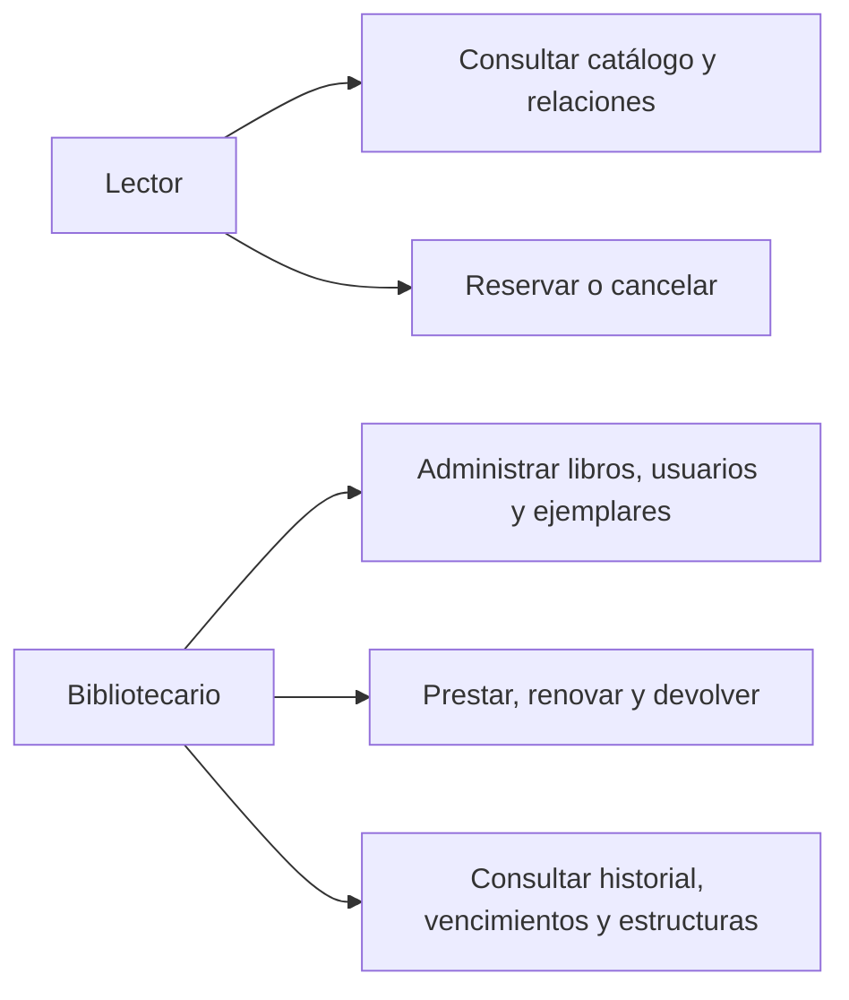
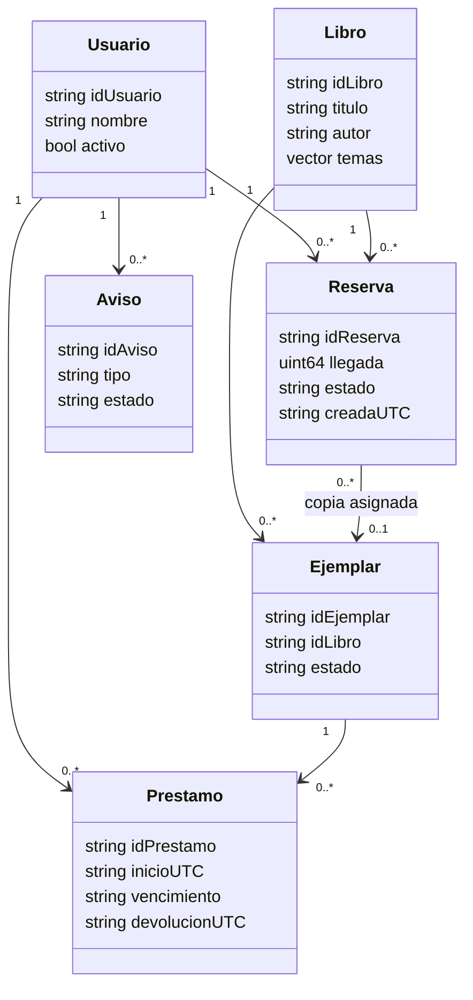
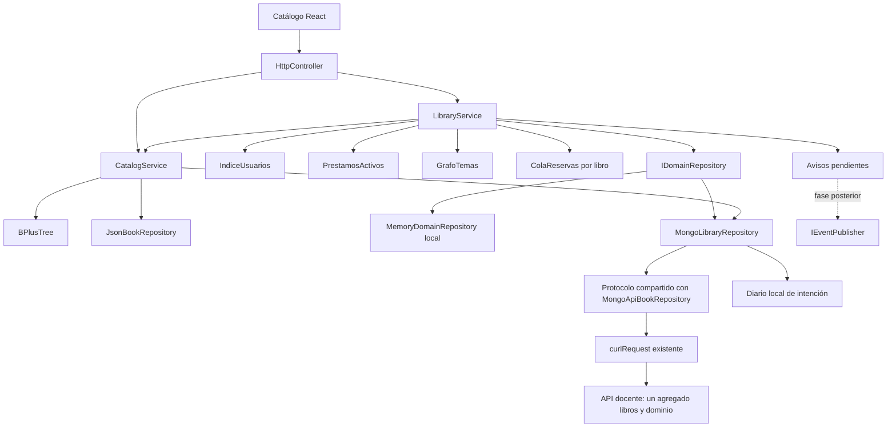
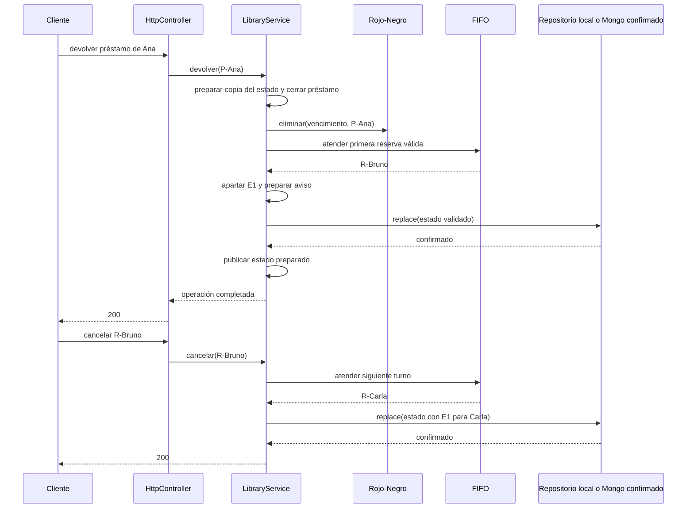
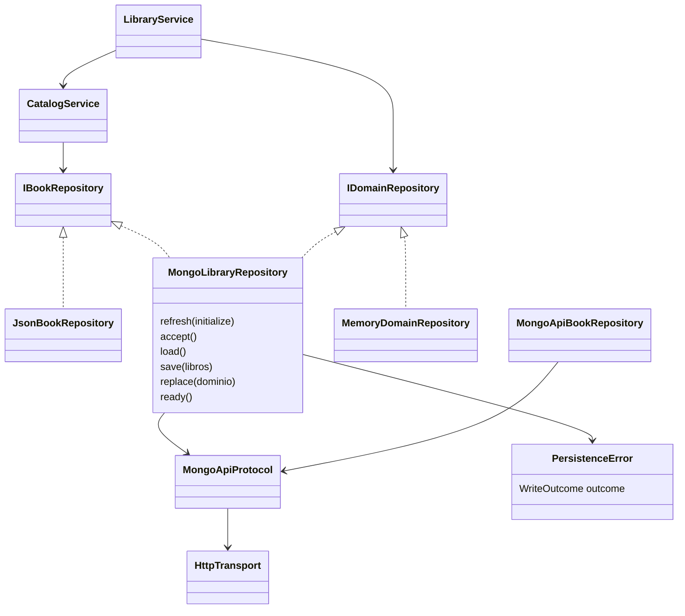

# Dominio y API de Biblioteca

La API combina el catálogo existente con usuarios, copias físicas, préstamos,
reservas y avisos. El contrato de solicitudes, respuestas y paginación está en
[OpenAPI 3.1](openapi.json). El proceso escucha en `127.0.0.1:8080`.
La pantalla del catálogo continúa usando `/api/libros` y la vista textual del B+.

El modo `--storage mongo` persiste la biblioteca completa y la reconstruye al
reiniciar. Ver [configuración y recuperación](PERSISTENCIA_MONGODB.md).
Las instrucciones de demo de esta sección corresponden al modo local JSON/memoria.

## Ejecutar y demostrar

Desde la raíz del repositorio en WSL, con las dependencias C++ ya instaladas:

```bash
cmake -S . -B build/debug -DCMAKE_BUILD_TYPE=Debug -DBUILD_TESTING=ON
cmake --build build/debug -j2
bash scripts/demo_biblioteca.sh
```

El script crea un JSON temporal, arranca su propio backend en un puerto libre y
ejecuta Ana → Bruno → Carla. Comprueba estados, referencias y snapshots tras cada
mutación. Exporta las entidades, reinicia el proceso e importa las reservas en
orden inverso para comprobar que la llegada original determina el turno.
Los archivos y procesos de demostración se limpian al terminar.

Para usar la API manualmente:

```bash
./build/debug/catalogo_api --storage local --initial data/libros_iniciales.json --working data/catalogo_web.json --port 8080
```

CORS permite los orígenes locales de Vite en el puerto 5173.
Se pueden añadir orígenes con `--origin https://origen-elegido.example`.
El perfil local permite administrar la biblioteca sin iniciar sesión. La
autorización de bibliotecario para administración, exportación y snapshots
requiere la futura fase de autenticación. El 403 actual señala un origen CORS
rechazado. La API emite 400, 404, 409, 413, 415 y 503 según OpenAPI.
El límite de cuerpo es 1 MiB y cada colección admite hasta 10 000 registros.
El dominio serializado también tiene un límite total de 1 MiB para permitir
restaurar toda exportación aceptada. Se rechaza la operación que lo exceda.
Los límites de texto se aplican en bytes UTF-8.

## Estado, identidad y fechas

| Entidad | Identidad y reglas |
|---|---|
| Libro | `idLibro` inmutable. Se reutiliza `Libro`. La edición retira la clave anterior e inserta la nueva en B+, y recalcula las aristas afectadas al cambiar temas. |
| Usuario | `idUsuario`, nombre y `activo`. Se reutiliza el registro del hash. Consultar por ID utiliza `IndiceUsuarios::buscar`. |
| Ejemplar | `idEjemplar` y `idLibro`. Disponible, prestado, apartado o retirado. Retirar o reincorporar solo se permite sobre copias libres o ya retiradas. |
| Prestamo | `idPrestamo`, ejemplar, usuario, inicio UTC, vencimiento y devolución UTC. Devolución vacía significa activo. Se conserva el registro después de devolver. |
| Reserva | `idReserva`, libro, usuario, llegada, estado, copia asignada y creación UTC. Pendiente → apartada → atendida. Pendiente y apartada pueden pasar a cancelada. |
| Aviso | `idAviso` generado por el servicio, tipo, destinatario, referencia y creación UTC. Los eventos de devolución y apartado quedan pendientes. |

Los IDs admiten entre 1 y 64 letras ASCII, números, guiones y guiones bajos.
Los IDs de negocio los aporta el cliente y se comprueba unicidad por entidad.
El servicio asigna instantes `AAAA-MM-DDTHH:MM:SSZ` y secuencias de llegada
enteras positivas representables exactamente en JSON/JavaScript.
Las fechas `AAAA-MM-DD` se validan según calendario gregoriano y años bisiestos.
El vencimiento inicial debe ser posterior al día actual UTC. Renovar exige una
fecha posterior a la vigente y sustituye la clave del Rojo-Negro.
En esta fase se permite renovar aunque existan reservas pendientes.

## Reglas de atención y conservación

Una copia admite un préstamo activo. Solo puede prestarse a un usuario activo.
Una copia apartada puede prestarse al lector de la reserva que la recibió.
Las reservas pendientes o apartadas son únicas por lector y libro.
La llegada la asigna el servicio al aceptar la reserva, con una secuencia global.
Las colas se organizan por libro y las copias libres se recorren en orden de alta.
Cada copia atiende el siguiente turno válido. Crear o reincorporar una copia
también permite atender reservas.

Devolver cierra el préstamo, elimina su clave del Rojo-Negro, libera la copia y
atiende la FIFO. Cancelar un apartado libera la copia para la reserva siguiente.
Desactivar un usuario con un préstamo activo se rechaza. Para usuarios sin
préstamos activos, la desactivación cancela sus reservas y reasigna sus apartados.
Las canceladas pueden quedar en la cola hasta que el recorrido las descarte.

El borrado de usuario rechaza operaciones pendientes. Con historial, lo
desactiva. El borrado de copia rechaza préstamos y apartados activos. Con
historial, la retira. Los registros sin referencias se eliminan físicamente.
Borrar un libro referenciado por cualquier ejemplar o reserva se rechaza.
Las operaciones de préstamo y reserva históricas se conservan.

## Fuentes de datos y confirmación

`CatalogService` es la única fuente de libros en el proceso. Tanto el catálogo
web como `LibraryService` lo consultan. `JsonBookRepository` conserva el
archivo de trabajo y la protección del catálogo inicial.

**En modo local**, `MemoryDomainRepository` guarda usuarios, ejemplares, préstamos, reservas,
avisos y la próxima secuencia durante la vida del proceso. Reiniciar vacía
esas entidades. Para conservar una sesión, exportar `GET /api/dominio`,
mantener el JSON de libros correspondiente y restaurar con `PUT /api/dominio`.
La importación es una operación administrativa explícita que reemplaza el
dominio completo. Valida todas las referencias contra los libros presentes.
Reconstruye hash y Rojo-Negro, y reordena las reservas pendientes por su llegada.
Las canceladas o ya atendidas no necesitan reconstruir un turno en espera.

Cada mutación de dominio copia sus registros y nodos reales, aplica los
algoritmos de las estructuras y verifica invariantes antes de llamar al
repositorio. `replace` retorna solo con confirmación. En Mongo un error puede ser
rechazado o incierto; el resultado incierto bloquea y conserva el diario para
relectura explícita, sin afirmar que el remoto no cambió. Después de confirmar
se intercambia el estado visible con una operación sin asignación.
Un rechazo conserva también la topología de los índices.
La edición de libros prepara B+ y grafo y confirma la instantánea JSON o Mongo antes de publicarlos.
El grafo se deriva del catálogo y se reconstruye al arrancar.

El servidor usa un trabajador para serializar solicitudes. El bloqueo existente
coordina las API que comparten el JSON de libros. La consola debe utilizar su
propio archivo de trabajo, como en la demostración existente.
La copia y validación completa tienen coste adicional al recorrido del índice.
La comprobación del grafo compara los temas de cada par de libros.
Esta implementación prioriza consistencia y comprobación en la demo local.

## Persistencia Mongo y avisos

`MongoLibraryRepository` implementa las interfaces de libros y dominio con un
único documento versionado que contiene ambos. Carga, valida y reconstruye todos
los índices al arrancar; conserva secuencias, historia e IDs de avisos. No se
requiere exportación/importación. Reutiliza el transporte HTTP y protocolo del
adaptador E2-B. [Diseño, capacidades reales y recuperación](PERSISTENCIA_MONGODB.md).

`IEventPublisher::publish(const Aviso&)` sigue siendo la frontera preparada.
Los avisos se persisten pendientes en el mismo agregado. RabbitMQ, publicación,
ack y worker siguen pendientes. El futuro worker deberá canalizar cambios por
el único escritor o usar un registro separado con contrato verificado; no puede
escribir avisos directamente en paralelo a reemplazos de esta instantánea.

## Diagramas editables

El caso de uso distingue las acciones del lector y de administración. Los
actores representan el diseño objetivo de autorización.









El retorno confirmado del diagrama incluye GET de verificación en modo Mongo.
Si queda incierto, no se ejecuta el intercambio ni se responde 200: se devuelve
503, se bloquea la biblioteca y se ofrece recuperación por lectura.


